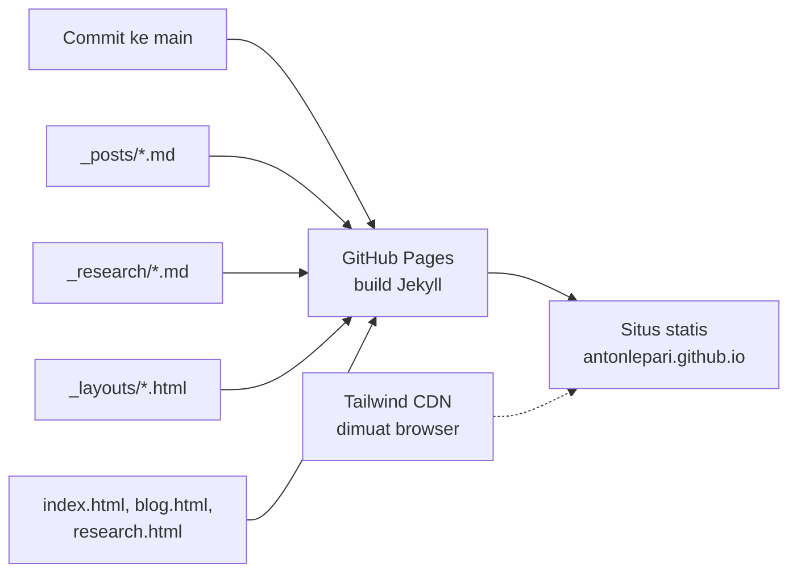

# antonlepari.github.io

Situs pribadi **Anton Lepari**: portfolio keamanan siber, blog artikel, dan catatan riset. Repo ini adalah sumber situs yang di-host di **GitHub Pages**, dibangun dengan **Jekyll** dan di-styling dengan **Tailwind CSS** (via CDN).

## Isi situs

| URL | Sumber di repo | Fungsi |
|-----|----------------|--------|
| `/` | `index.html` | Portfolio: profil, sertifikasi, project, artikel terbaru, kontak |
| `/blog/` | `blog.html` | Daftar artikel |
| `/blog/<slug>/` | `_posts/*.md` | Satu artikel |
| `/research.html` | `research.html` | Daftar catatan riset |
| `/research/<nama>/` | `_research/*.md` | Satu catatan riset |
| `/research.txt` | `research.txt` | Arsip catatan format RFC (2022) |
| `/feed.xml` | dibuat `jekyll-feed` | RSS artikel blog |
| `/404.html` | `404.md` | Halaman tidak ditemukan |
| `/docs/*.pdf` | `docs/` | PDF sumber rujukan riset (GCI, Perpres 18/2020) |

## Arsitektur

Situs ini statis: tidak ada server, database, atau proses build kustom. Setiap commit ke branch `main` memicu build Jekyll bawaan GitHub Pages, lalu hasilnya dipublikasikan.



**Alur konten:**

```
_posts/2026-11-16-judul.md   --(layout: post)-->     /blog/<slug>/
_research/nama.md            --(layout: research)--> /research/nama/
        \--> semua halaman dibungkus _layouts/default.html (header, menu, footer, dark mode)
```

Komponen utamanya:

- **Jekyll** (bawaan GitHub Pages), dengan plugin `jekyll-feed`.
- **Layout:** `default.html` (kerangka semua halaman), `post.html` (artikel), `research.html` (catatan riset).
- **Koleksi `research`:** didefinisikan di `_config.yml`, tampil di `/research/:name/` dan memakai layout `research` secara otomatis.
- **Tailwind CSS:** dimuat dari CDN di tiap halaman, dengan `darkMode: 'class'`. Pilihan tema gelap/terang disimpan di `localStorage`. Plugin `typography` dipakai untuk tampilan isi artikel.
- **Favicon:** emoji 💀 sebagai SVG yang ditanam langsung di `<head>`.

Catatan: `index.html` diawali front matter `---` kosong supaya Jekyll memprosesnya (diperlukan untuk bagian *Latest Articles*). Jangan dihapus.

## Struktur repo

```
.
├── _config.yml            # pengaturan situs, permalink, koleksi, plugin
├── _layouts/
│   ├── default.html       # kerangka halaman (header, footer, dark mode)
│   ├── post.html          # tampilan artikel blog
│   └── research.html      # tampilan catatan riset
├── _posts/                # artikel blog (YYYY-MM-DD-judul.md)
├── _research/             # catatan riset (nama-catatan.md)
├── assets/img/            # gambar (mis. profile.jpg)
├── docs/                  # PDF sumber rujukan
├── css/, js/              # sisa situs lama (lihat Pembersihan)
├── index.html             # portfolio
├── blog.html              # daftar artikel
├── research.html          # daftar catatan riset
├── research.txt           # arsip catatan format RFC
├── 404.md
└── README.md              # tidak diterbitkan (di-exclude di _config.yml)
```

## Menulis konten

**Artikel blog:** buat `_posts/2026-11-20-judul-singkat.md`

```markdown
---
title: "Judul Artikel"
date: 2026-11-20 09:00:00 +0700
permalink: /blog/judul-singkat/
tags: [pentest, tools]
---

Paragraf pertama (jadi ringkasan di daftar artikel).
```

**Catatan riset:** buat `_research/nama-catatan.md`

```markdown
---
title: "Judul Catatan"
date: 2026-11-20
source: "Nama paper, jurnal, atau situs"
tags: [tag1, tag2]
summary: "Satu kalimat untuk kartu di daftar."
---

Isi catatan dalam Markdown.
```

Setelah commit ke `main`, tunggu 1-2 menit. Daftar blog, daftar riset, *Latest Articles*, dan RSS diperbarui otomatis. Selalu tulis `title` dengan tanda kutip, dan sertakan zona waktu `+0700` pada `date` artikel.

Jika artikel tidak muncul, cek: nama file sesuai format, `date` tidak di masa depan, front matter diawali `---` di baris pertama, lalu lihat tab **Actions** untuk pesan error build.

## Domain

Situs saat ini dilayani dari `antonlepari.github.io` (tidak ada file `CNAME`). Jika custom domain dipasang kembali:

1. Pastikan `dig <subdomain> CNAME +short` mengembalikan `antonlepari.github.io.` (perhatikan titik di akhir nilai pada panel DNS).
2. Isi **Settings → Pages → Custom domain**, dan pastikan file `CNAME` di repo berisi nilai yang sama.
3. Aktifkan **Enforce HTTPS** setelah DNS check berhasil, lalu ubah `url` di `_config.yml` menjadi `https://...`.

Selama custom domain aktif, `antonlepari.github.io` dialihkan ke domain tersebut. Jika DNS bermasalah, kedua alamat ikut tidak bisa diakses.

## Keamanan repo

Repo ini **publik**, termasuk seluruh riwayat commit. Jangan commit kredensial, token, file `.env`, hasil pentest, data klien, atau draf yang belum siap terbit.

## Catatan dan to-do

- `CV.pdf` belum ada di repo, sehingga tombol **Download CV** di `index.html` mengarah ke 404.
- Logo sertifikasi diganti emoji karena file gambarnya tidak ada di repo.
- Tailwind Play CDN praktis, tetapi pada dasarnya ditujukan untuk pengembangan. Untuk produksi, bisa diganti dengan CSS hasil build Tailwind CLI.
- **Pembersihan:** `css/styles.css` dan `js/scripts.js` tidak dirujuk halaman mana pun saat ini, dan `docs/.htaccess` tidak berfungsi di GitHub Pages. Hapus kalau memang tidak dipakai.
